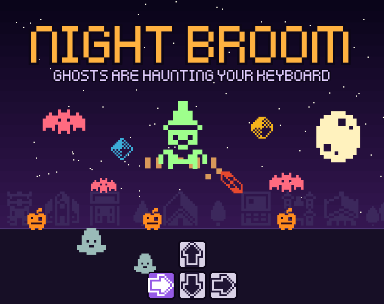
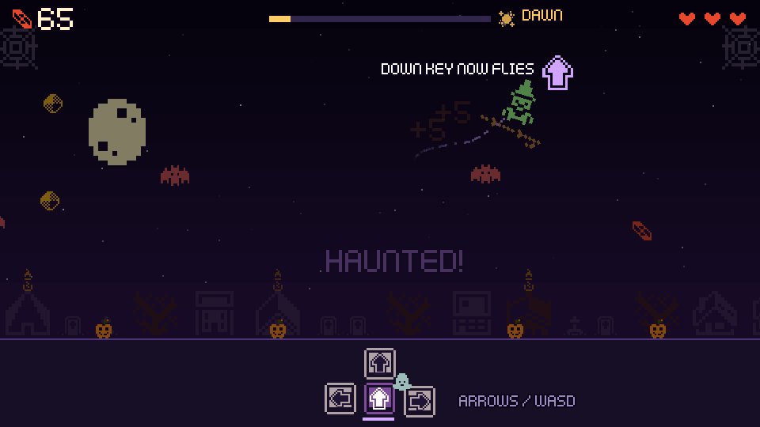
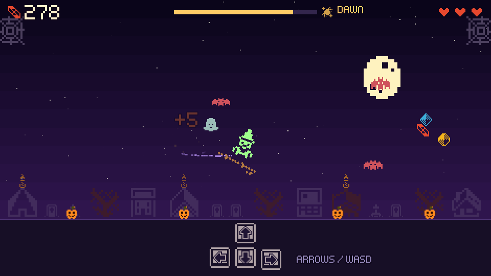
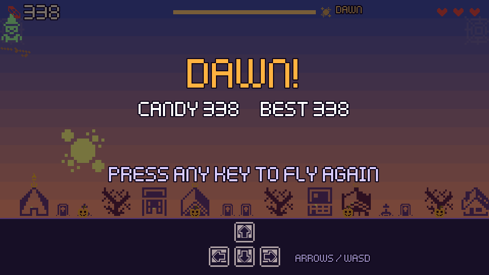

# Night Broom

A tiny Halloween arcade game made for **Micro Jam 069** (theme: *Halloween*, prerequisite: *haunted keyboard controls*).



You fly a witch over a sleeping village and grab candy until dawn. Ghosts keep diving into the keyboard at the bottom of the screen and possessing keys. A possessed key turns purple and its arrow flips to a new direction, so Up might now fly you down. The on-screen keycaps always show what each key does right now. Once the haunting gets serious, a jack-o'-lantern appears: grab it to chase every ghost out at once.

**Play it in the browser:** ITCH_URL

## Controls

| Key | Action |
| --- | --- |
| Arrow keys or WASD | Fly (check the keycaps once ghosts arrive) |
| Any key | Start / fly again |

Grab candy in quick runs for a combo (up to +5 each). Bats cost a life; three hits and you fall. The night lasts two minutes.

## Screenshots

| | |
| --- | --- |
|  |  |
|  |  |

## How the haunting works

Each key holds a direction. When a ghost lands on a key, that key's direction changes (the first time it's always a full reverse, later it's random). The haunt lasts 9 to 13 seconds, and a small bar under the key drains to show how long is left. More keys can be haunted at once as the night goes on, up to all four. A jack-o'-lantern appears once two keys are haunted or one haunt has lasted 5 seconds; grabbing it frees every key and gives back a life. The first haunt always happens in a calm moment, slows time, and shows a short tip by the witch.

## Playtesting

The web build publishes its state to the page when opened with `?bot=1`, and `tools/bot.js` (Playwright) plays full nights against it with three policies: `aware` reads the key mapping the keycaps show, `naive` assumes normal arrows, and `human` models a first-timer (reaction lag, notices a remapped key 1-1.5 s late, steering noise). Difficulty was tuned so the first-timer bot reaches dawn about half the time (5 of 9 nights) while the aware bot always does, and a bot that ignores the keycaps collects about two thirds of the aware bot's candy. Sound levels were set from ffmpeg loudness measurements rather than by ear. A separate first-look test (an AI agent shown three screenshots and nothing else) led to the drain bars, the "FREES KEYS" tag on the pumpkin and the dawn label.

## Build

Godot 4.7.2 with web export templates installed.

```sh
./build.sh            # exports build/web and zips it to build/night-broom-web.zip
```

The web export uses the no-threads template, so it runs on itch.io without special headers.

## Credits

All art is by Kenney (CC0); sound effects are CC0 recordings by Kenney, qubodup, jaggedstone and Jordan Irwin. Music is "Danse Macabre" by Kevin MacLeod (CC BY 4.0). Full list in [CREDITS.md](CREDITS.md).

## AI disclosure

No AI-generated art, sound or music is used. Every sprite is from Kenney's 1-Bit Pack, every sound effect is a human-made CC0 recording (see CREDITS.md), and the music is Kevin MacLeod's. The code was written with help from an AI coding assistant (Claude), which the Micro Jam 069 rules allow ("using AI for coding or debugging").

## License

Code: MIT (see [LICENSE](LICENSE)). Assets keep their own licenses (see [CREDITS.md](CREDITS.md)).
